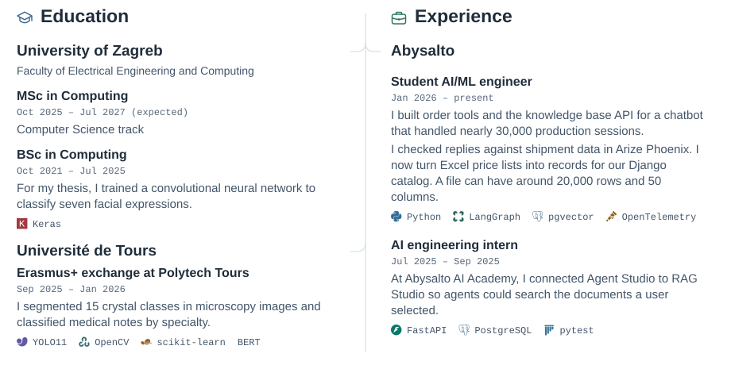

# Petar Majić

I’m a student AI/ML engineer at Abysalto and a master’s student at the University of Zagreb’s Faculty of Electrical Engineering and Computing (FER). I worked on a retail support chatbot that handled **nearly 30,000 sessions in production**. I now write Python code that turns supplier price lists into product records for our Django backend. A single Excel file can have around 20,000 rows and 50 columns.

## Experience and education

<picture>
  <source media="(max-width: 600px) and (prefers-color-scheme: dark)" srcset="assets/timeline-mobile-dark.svg">
  <source media="(max-width: 600px)" srcset="assets/timeline-mobile.svg">
  <source media="(prefers-color-scheme: dark)" srcset="assets/timeline-dark.svg">
  
</picture>

## Projects from the timeline

- **Retail engineering.** Follow a split order through the chatbot or see how supplier spreadsheets reach the catalog. [Support assistant](https://github.com/petarmajic/ai-engineering-case-studies/blob/master/cases/support-assistant.md) · [Supplier catalog](https://github.com/petarmajic/ai-engineering-case-studies/blob/master/cases/catalog-intake.md)
- **Polytech Tours.** Compare a predicted crystal mask with its annotation, or see which edges OpenCV picks out in the Mona Lisa. [Crystal segmentation](https://github.com/petarmajic/urinary-crystal-segmentation) · [AI and Applications](https://github.com/petarmajic/ai-and-applications)
- **AI Academy.** See how an agent calls a search tool for a particular document collection. [Agent Studio](https://github.com/petarmajic/ai-agent-studio)
- **Bachelor’s thesis.** See how accuracy varied across seven facial expression classes. [Facial expression recognition](https://github.com/petarmajic/facial-expression-recognition)
